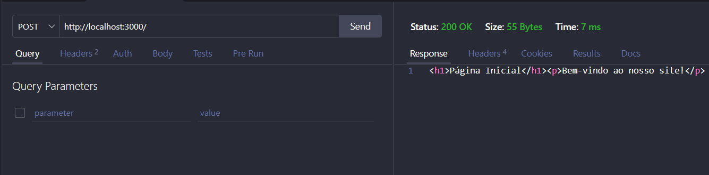
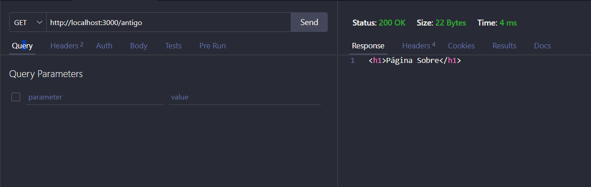
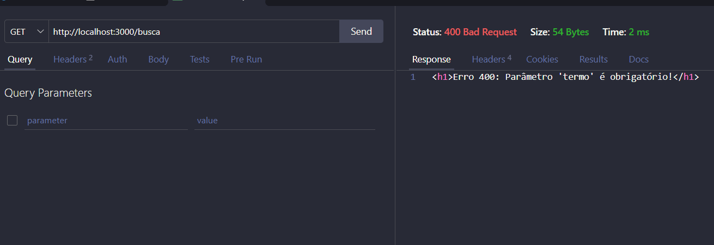
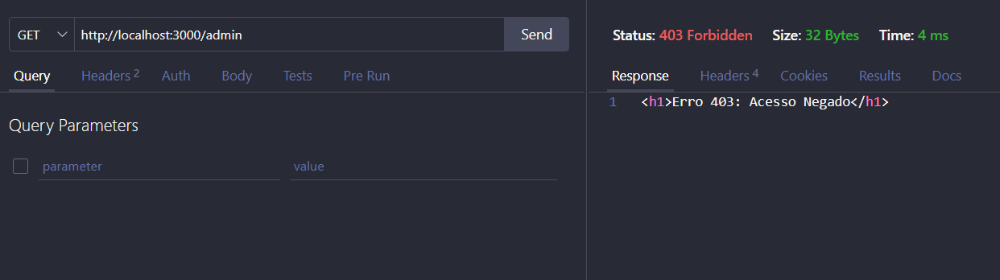
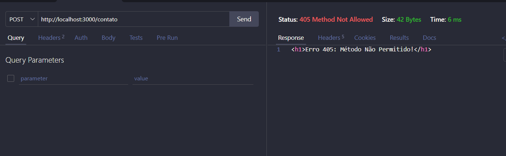

# Ado 1 - Protocolos HTTP

## Fundamentos do HTTP

### Cliente e Servidor
Quando digitamos uma URL no navegador acontece 4 ações:
1. **DNS:** O navegador traduz o nome do domínio ou endereço local para seu ip.
2. **Conexão:** É aberta uma conexão de comunicação direta (via protocolo TCP) entre a sua máquina (cliente) e o servidor na porta 3000.
3. **Requisição:** O navegador envia uma mensagem estruturada pedindo o recurso da rota.
4. **Resposta:** O servidor processa o pedido, encontra o arquivo ou os dados e envia outra mensagem estruturada de volta (a resposta HTTP) contendo o código HTML, CSS e imagens. O navegador lê esse código e desenha a página na sua tela.


### Anatomia da Requisição e da Resposta

Toda mensagem que trafega pelo protocolo HTTP possui uma estrutura fixa dividida em três partes principais: a **Linha Inicial** (que define o que fazer ou o resultado), os **Cabeçalhos** (que trazem metadados sobre a comunicação) e o **Corpo** (que carrega o conteúdo principal).

#### Anatomia da Requisição 
```
GET /admin HTTP/1.1  <-- LINHA INICIAL
Host: localhost:3000  <-- CABEÇALHO
User-Agent: Thunder Client (https://thunderclient.com) <-- CABEÇALHO
Accept: text/html,application/xhtml+xml  <-- CABEÇALHO
```
**Linha Inicial:** - Contém o método HTTP (GET), o caminho do recurso solicitado obtido por meio do `req.url` e a versão do protocolo utilizada.\
**Cabeçalhos (Headers):** - Trazem informações adicionais enviadas pelo cliente. O `Host` indica o endereço do servidor, o `User-Agent` identifica qual ferramenta realizou o disparo e o `Accept` informa os formatos que o cliente consegue processar.\
**Corpo (Body):** Ficou completamente vazio porque requisições do tipo `GET` transferem dados apenas pelos parâmetros da URL e não transportam uma carga útil de dados no corpo.

#### 2. Anatomia da Resposta 
```
HTTP/1.1 403 Forbidden  <-- LINHA INICIAL
Content-Type: text/html; charset=utf-8  <-- CABEÇALHO
Content-Length: 32 <-- CABEÇALHO
Date: Thu, 15 Oct 2026 22:56:00 GMT  <-- CABEÇALHO
Connection: keep-alive <-- CABEÇALHO
--LINHA EM BRANCO--
<h1>Erro 403: Acesso Negado</h1>  <-- CORPO (Conteúdo)
```

**Linha Inicial:** Contém a versão do protocolo (`HTTP/1.1`), seguida pelo código de status numérico (`403`) e a sua respectiva mensagem descritiva textual (`Forbidden`).\
**Cabeçalhos (Headers):** Metadados gerados pelo Node.js. O `Content-Type` avisa que o cliente vai receber um texto em formato HTML codificado em UTF-8, e o `Content-Length` indica o tamanho exato da mensagem (32 bytes).\
**Corpo (Body):** É o conteúdo entregue pelo comando `res.end()`. Neste caso, a string de texto contendo a estrutura HTML que avisa na tela que o acesso àquela área foi rejeitado.

### Métodos HTTP

| Método | Para que serve | Seguro? | Idempotente? |
| :--- | :--- | :--- | :--- |
| **GET** | Solicita e lê informações do servidor, sem alterar nada. | **Sim** | **Sim** |
| **POST** | Envia dados novos para o servidor criar ou processar um registro. | Não | Não |
| **PUT** | Substitui ou atualiza completamente um registro existente. | Não | **Sim** |
| **PATCH** | Faz uma alteração pequena ou parcial em um registro. | Não | Não |
| **DELETE** | Remove um registro específico do servidor. | Não | **Sim** |

* **Método Seguro:** É aquele que apenas lê informações e nunca modifica ou destrói dados no servidor (ex: GET).
* **Método Idempotente:** Significa que se você fizer a mesma requisição várias vezes seguidas, o estado final do servidor será exatamente o mesmo da primeira execução (ex: PUT, DELETE).

### Códigos de Status
Os códigos de status informam o resultado da requisição e são divididos em famílias:
* **1xx (Informação):** O pedido foi recebido e o processo continua.
* **2xx (Sucesso):** O pedido deu certo e foi concluído com êxito.
* **3xx (Redirecionamento):** O cliente precisa ir para outro endereço para concluir a ação.
* **4xx (Erro do Cliente):** Problema no pedido enviado (falta de dados, rota errada ou falta de permissão).
* **5xx (Erro do Servidor):** O servidor quebrou ou falhou ao tentar processar o pedido.

### Significados
  * **200 OK:** A requisição funcionou perfeitamente.
  * **201 Created:** Um novo recurso foi criado com sucesso no servidor.
  * **301 Moved Permanently:** O endereço mudou para sempre. O navegador grava o novo caminho automaticamente.
  * **302 Found:** O endereço mudou apenas temporariamente.
  * **304 Not Modified:** O conteúdo não mudou desde o último acesso e o cache local do navegador será usado.
  * **400 Bad Request:** Requisição errada ou faltando dados obrigatórios.
  * **401 Unauthorized:** O usuário não está autenticado (precisa fazer login primeiro).
  * **403 Forbidden:** O servidor sabe quem é o usuário, mas barra o acesso por falta de nível de permissão.
  * **404 Not Found:** A página ou rota digitada não existe no servidor.
  * **405 Method Not Allowed:** O método HTTP usado não é aceito por aquela rota específica.
  * **500 Internal Server Error:** Ocorreu um erro interno genérico ou quebra no código do servidor.

* **Diferença entre 401 e 403:** No `401 Unauthorized`, o usuário não está identificado (não fez login). No `403 Forbidden`, o usuário já está logado, mas não tem autorização ou cargo suficiente para entrar ali (ex: tentar acessar o `/admin`).
* **Diferença entre 301 e 302:** O `301` avisa que a página mudou de lugar permanentemente e atualiza os links; o `302` avisa que a mudança é provisória e o endereço original voltará a ser usado depois.

### Cabeçalhos Utilizados
**Content-Type:** Avisa o formato do arquivo que está sendo enviado (text/html; charset=utf-8).\
**Content-Length:** Mostra o tamanho do corpo da resposta medido em bytes.\
**Location:** Informa o endereço de destino para onde o navegador deve ir durante um redirecionamento.\
**Allow:** Diz quais métodos são aceitos em uma rota quando ocorre o erro 405 (ex: `Allow: GET`).\
**Cache-Control:** Define as regras sobre como o navegador deve guardar a página em cache.\
**User-Agent:** Identifica qual navegador e sistema operacional o cliente está utilizando.\
**Accept:** Informa os formatos de mídia que o cliente consegue entender ao receber as respostas.


### HTTP é Stateless
Significa que o protocolo não guarda memória de estado. Cada ciclo de requisição e resposta é tratado de forma totalmente nova e isolada. O servidor esquece quem é o cliente assim que envia a resposta, sendo necessário usar cookies ou tokens caso queira lembrar de ações passadas.


### HTTP x HTTPS
A diferença principal é a segurança. O HTTP envia as mensagens em formato de texto aberto, facilitando obstrução no caminho. O HTTPS aplica uma camada extra de criptografia, embaralhando os dados para garantir a confidencialidade e a integridade da comunicação.

## Evidências

###  Rota `/` (Página Inicial)

*O print mostra a resposta da rota inicial carregando o HTML da Home com o status 200 OK.*

---

###  Rota `/sobre` (Página Sobre)

*O print exibe a rota /sobre retornando a página informativa com sucesso e status 200 OK.*

---

### Rota `/antigo` (Redirecionamento 301)

*O print mostra o cabeçalho de resposta contendo o Location: /sobre, provando que o servidor disparou o redirecionamento.*

* **Saída do comando `curl -i` no terminal:**
```bash
$ curl -i http://localhost:3000/antigo
HTTP/1.1 301 Moved Permanently
Location: /sobre
Connection: keep-alive
Content-Length: 0
```

### Rota `/busca` (Busca sem Parâmetro)

*O print exibe o erro 400 Bad Request gerado ao tentar acessar a busca sem enviar o parâmetro obrigatório termo.*

* **Saída do comando `curl -i` no terminal:**
```bash
$ curl -i http://localhost:3000/busca
HTTP/1.1 400 Bad Request
Content-Type: text/html; charset=utf-8
Content-Length: 54

<h1>Erro 400: Parâmetro 'termo' é obrigatório!</h1>
```

### Rota `/admin` (Acesso Negado 403)

*O print mostra a página de erro 403 Forbidden bloqueando o acesso do cliente à área do administrador.*


### Rota `/contato` (Método Não Permitido 405)

*O print exibe o erro 405 Method Not Allowed ao tentar enviar um POST para uma rota que só permite o método GET.*

* **Saída do comando `curl -i` no terminal:**
```bash
\$ curl -i -X POST http://localhost:3000/contato
HTTP/1.1 405 Method Not Allowed
Allow: GET
Content-Type: text/html; charset=utf-8
Content-Length: 39

<h1>Erro 405: Método Não Permitido!</h1>
```


### Minha Conclusão
Depois de fazer essa pesquisa, a principal mudança que eu faria nos servidores das aulas seria começar a usar os códigos de status certos para os erros. Em aula, a gente costuma mandar quase tudo com 200 OK e só escreve o texto do erro na tela. Agora eu mudaria isso para deixar o código mais correto, usaria o 400 se o usuário esquecer de digitar algum parâmetro na URL, em vez de deixar tudo como se tivesse dado certo. É uma mudança simples no res.writeHead, mas que já deixa o nosso servidor funcionando do jeito certo.

### Referências Bibliográficas

FIELDING, R.; NOTTINGHAM, M.; RESCHKE, J. (ed.). RFC 9110: HTTP Semantics. IETF, 2022. Disponível em: <https://rfc-editor.org>. Acesso em: 15 out. 2026.
MOZILLA. HTTP. MDN Web Docs. Disponível em: <https://mozilla.org>. Acesso em: 15 out. 2026.
NODE.JS. HTTP. Node.js Documentation. Disponível em: <https://nodejs.org>. Acesso em: 15 out. 2026.

GOOGLE. Gemini (Modelo Advanced). Ferramenta de inteligência artificial generativa.
* Data de uso: 15 out. 2026.
* Finalidade: Dúvidas sobre como simplificar o roteamento nativo.
* Arquivos impactados: src/server.js e src/routes/rotas.js.